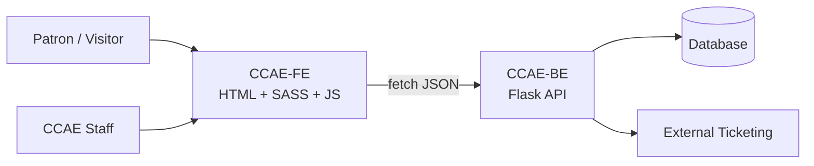

# Introduction

CCAE is the project that focuses on Improving an already existing website using Open Coding Society website system and style, the people working on this project Tristan Chiu, Mateo Durand Amador, and Yue Barbara (change to actual full name later) 

## Project Requirements

The requirements for this project go as follows

1. Find a website to improve
2. set up a github organization, repository, page, etc. to work on the site with kanban boards and proper workflows
3. make issues and work on issues which will lay steps for making and improving the website
4. etc. like testing submitting final website to organizations, minor adjustments, you know, etc.

---

##  History of CCAE

The California Center for the Arts, Escondido (CCAE) was created to bring more cultural, artistic, and educational opportunities to Escondido and the surrounding North San Diego County region. Its history began long before the building opened, with local residents and civic leaders working to make the arts a bigger part of community life.

### License

The Apache license has its roots in Fastpages.  Thus, it carries that license forward.  However, most of the code is likely unrecognizable from those original roots.

There's also a license for CCAE if it gets accepted 

### Key Features

- **Code Examples**: the FE will try to interact with the BE to get most chunks of data, making the FE pretty light on it's own and most code in it will be like import ____ from ____ somewhat 
- **Catalogue and announcements of events in Escondido California**: The main purpose of CCAE is to display and announce real events going down in the area for people who are interested.
- **Profile System, Settings Options, Engagement Activities, and more NEW Features**: Features for a custom profile with username, password, settings, achievements, surveys, reccomendation adjustments, etc.  

### Contributions

- **Notable Contributions**: Highlights significant contributions to the project, including theme development, search and tagging functionality, GitHub API integration, and the incorporation of GitHub Projects into GitHub pages. Contributors such as Tirth Thakker, Mirza Beg, and Toby Ledder have played crucial roles in these developments.

- **Blog Contributions**:  Often students contribute articles and blogs to this project.  Their names are typically listed in the front matter of their contributing post.

---

