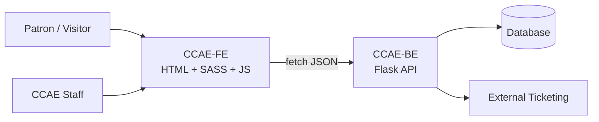

### ReadMe will have regular updates as our project comes along

# Introduction

North County Special Needs Community Foundation is the website that focuses on building a community for people with down syndrome. this project is a website revamp for NCSNCF, Improving an already existing website using Open Coding Society website system and style, the people working on this project Tristan Chiu, Mateo Durand Amador, and Yue Barbara Zhao

## Project Requirements

The requirements for this project go as follows

1. Find a website to improve
2. set up a github organization, repository, page, etc. to work on the site with kanban boards and proper workflows
3. make issues and work on issues which will lay steps for making and improving the website
4. etc. like testing submitting final website to organizations, minor adjustments, you know, etc.

---

##  History of NCSNCF

 North County Special Needs Community Foundation (NCSNCF) was established in 2011 to expand educational opportunities and support for adults with developmental disabilities in the Poway community. Its efforts grew from earlier community programs, including a Special Olympics softball team formed in 1998, and developed into a broader mission of bringing families together, building friendships, and creating more housing and educational opportunities for individuals with developmental disabilities.

### License

The Apache license has its roots in Fastpages.  Thus, it carries that license forward.  However, most of the code is likely unrecognizable from those original roots.

There's also a license for CCAE if it gets accepted 

### Key Features

- **Code Examples**: the FE will try to interact with the BE to get most chunks of data, making the FE pretty light on it's own and most code in it will be like import ____ from ____ somewhat 
- **Catalogue and announcements of events in Special Needs Community**: The main purpose of NCSNCF is to display and announce real events going down in the area for people who are interested.
- **Profile System, Settings Options, Engagement Activities, and more NEW Features**: Features for a custom profile with username, password, settings, achievements, surveys, reccomendation adjustments, etc.  

### Contributions

- **Notable Contributions**: Mateo D.A. brought survey questions, README, ____, etc. Tristan Chiu brought _____, etc. Yue Zhao brought ___, etc.
- **Blog Contributions**:  When it comes to what we have on our site visibly...  

---

